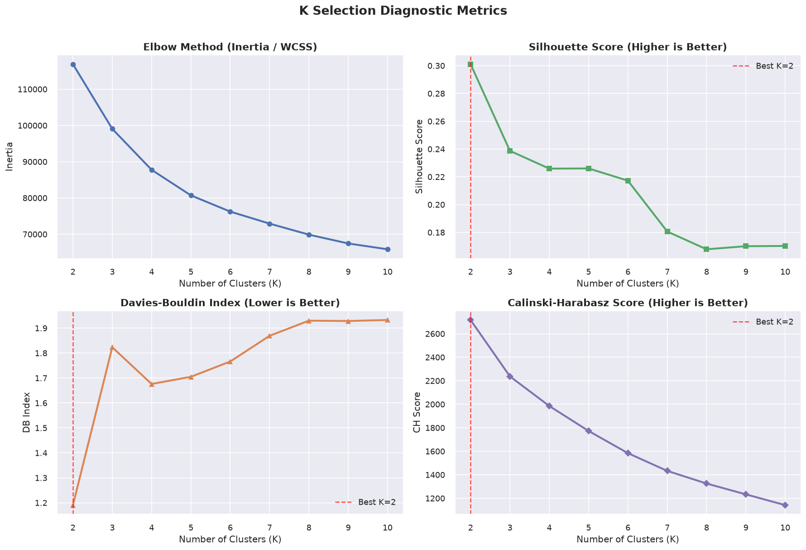
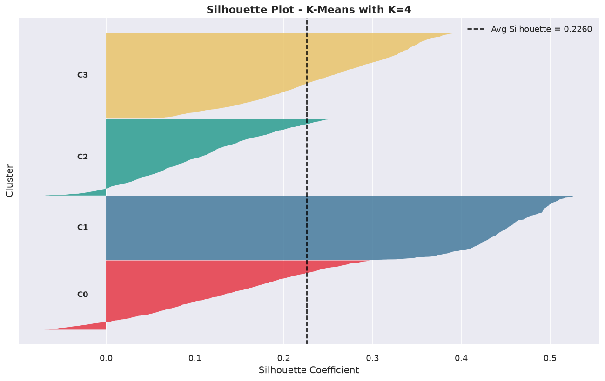
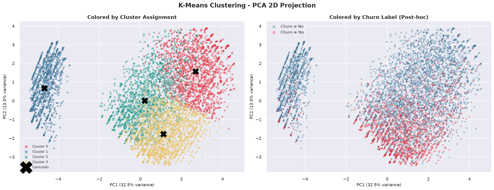
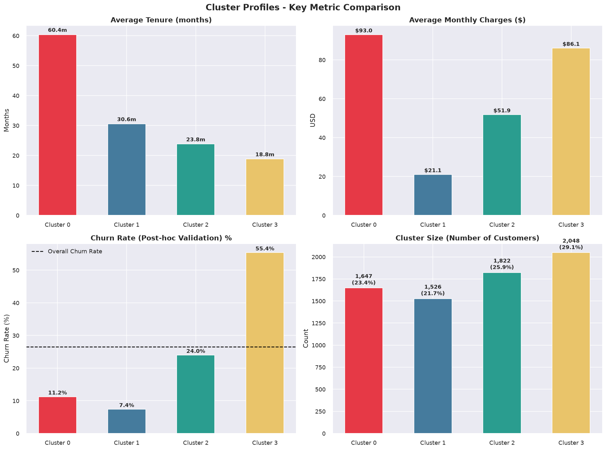
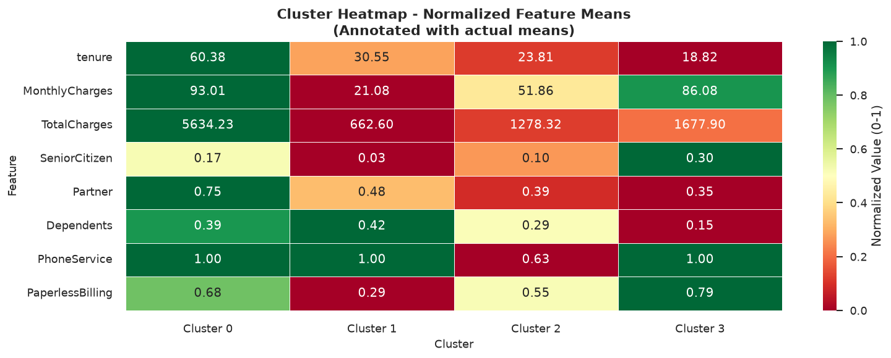
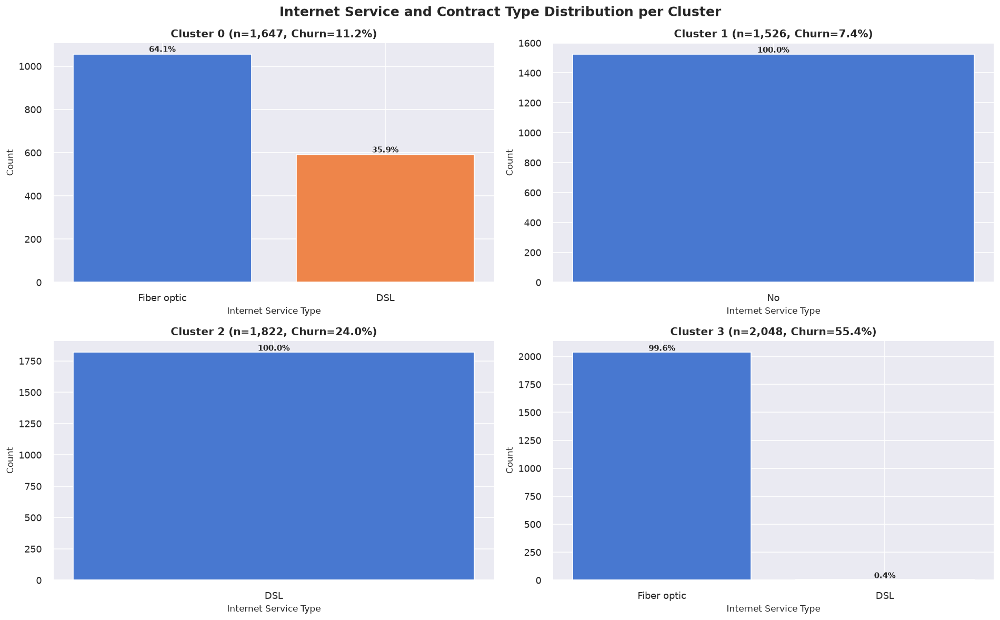
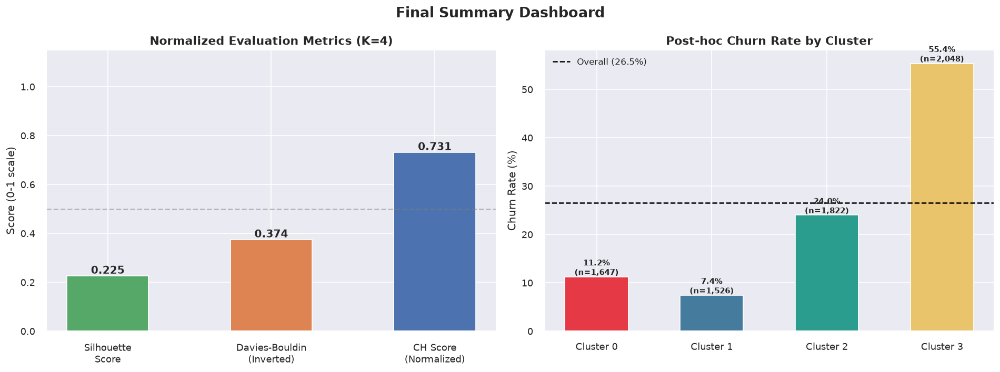

# Telecom Customer Segmentation using K-Means Clustering

A comprehensive, production-grade unsupervised machine learning pipeline for telecom customer behavioral segmentation. This project clusters customers based on service utilization, account tenure, contract structures, and expenditure patterns without using historical churn labels during model training, followed by post-hoc validation to uncover critical churn dynamics.

---

## Table of Contents

- [Project Overview](#project-overview)
- [Key Business Insights](#key-business-insights)
- [Methodology and Pipeline Architecture](#methodology-and-pipeline-architecture)
- [Exploratory Data Analysis and Preprocessing](#exploratory-data-analysis-and-preprocessing)
- [Optimal Cluster Selection (K Selection)](#optimal-cluster-selection-k-selection)
- [Model Evaluation and Validation](#model-evaluation-and-validation)
- [Dimensionality Reduction (PCA)](#dimensionality-reduction-pca)
- [Customer Personas and Cluster Profiles](#customer-personas-and-cluster-profiles)
- [Strategic Business Recommendations](#strategic-business-recommendations)
- [Knowledge Base and Saved Artifacts](#knowledge-base-and-saved-artifacts)
- [Repository Structure](#repository-structure)
- [Installation and Setup](#installation-and-setup)
- [License and Attribution](#license-and-attribution)

---

## Project Overview

In telecommunications, customer retention is substantially more cost-effective than new customer acquisition. While supervised churn prediction models classify whether an individual might leave, unsupervised customer segmentation addresses a complementary strategic objective: understanding distinct customer behavioral archetypes, expenditure habits, and service engagements to design targeted, proactive retention initiatives.

This project implements an end-to-end unsupervised clustering system using the K-Means algorithm on 7,043 telecom customer records. Churn labels and customer identifiers were strictly isolated during training to ensure purely behavioral pattern discovery. Post-hoc evaluation subsequently revealed that the learned segments exhibit starkly differentiated churn rates ranging from 7.4% to 55.4%, providing immediate commercial utility.

---

## Key Business Insights

- **Identification of At-Risk High-Spenders**: Cluster 3 represents 29.1% of the total customer base (2,048 customers) with high monthly expenditure ($86.08 average), yet suffers from a 55.4% churn rate driven by month-to-month fiber optic contracts without technical support add-ons.
- **High-Value Loyalty Pillar**: Cluster 0 accounts for 23.4% of the customer base (1,647 customers) who generate the highest revenue ($93.01 monthly, $5,634.23 lifetime), maintain long tenure (60.4 months average), and exhibit low churn (11.2%).
- **Stable Low-Maintenance Segment**: Cluster 1 comprises 21.7% of customers (1,526 accounts) who use only basic phone services without internet subscriptions, demonstrating the lowest churn rate (7.4%) and highest long-term contractual stability.
- **Mid-Tier Upgrade Candidates**: Cluster 2 captures 25.9% of customers (1,822 accounts) utilizing legacy DSL services with moderate tenure (23.8 months) and moderate churn (24.0%), serving as primary targets for fiber migration incentives.

---

## Methodology and Pipeline Architecture

The analysis follows a disciplined data science workflow designed for reproducibility and artifact persistence:

1. **Data Ingestion and Integrity Audit**: Type validation, handling whitespace-encoded missing values in numerical columns, and dropping unique identifier keys (`customerID`).
2. **Feature Engineering and Encoding**: Converting binary categorical indicators to binary integers, ordinal mapping for service dependencies, and one-hot encoding for nominal categories.
3. **Feature Standardization**: Transforming all 23 model features using `StandardScaler` to ensure zero mean and unit variance, preventing high-magnitude monetary features from dominating distance calculations.
4. **Diagnostic Cluster Optimization**: Evaluating K across the range [2, 10] using four complementary metrics: Inertia (Within-Cluster Sum of Squares), Silhouette Score, Davies-Bouldin Index, and Calinski-Harabasz Index.
5. **Final K-Means Model Execution**: Fitting the model at optimal K=4 with `k-means++` centroid initialization, `n_init=50` randomized restarts, and `max_iter=500`.
6. **Dimensionality Reduction**: Applying Principal Component Analysis (PCA) to compute 2D and 3D projections strictly for spatial visualization and centroid interpretation.
7. **Post-Hoc Churn Validation**: Cross-referencing unsupervised cluster assignments against ground-truth churn labels to validate behavioral segregation against commercial business outcomes.
8. **Artifact Serialization**: Exporting trained models, scalers, projection matrices, diagnostic figures, and persona tables to a dedicated knowledge base.

---

## Exploratory Data Analysis and Preprocessing

The raw dataset contains 7,043 customer records across 20 attributes covering demographic information, account details, and subscribed services.

### Data Cleaning Summary
- The `TotalCharges` column contained 11 whitespace-only strings representing newly onboarded customers with tenure equal to 0. These were imputed using the median total charges to preserve sample integrity.
- The `customerID` attribute was removed as an uninformative identifier.
- The `Churn` column was isolated into a separate validation series and excluded from model inputs.

### Preprocessing and Scaling
All remaining features were transformed into a 23-dimensional numerical matrix:
- Direct binary encoding for attributes such as `Partner`, `Dependents`, `PhoneService`, and `PaperlessBilling`.
- One-hot encoding for multi-class nominal features (`InternetService`, `PaymentMethod`).
- `StandardScaler` applied across the entire feature matrix, yielding mean 0.00 and standard deviation 1.00.

---

## Optimal Cluster Selection (K Selection)

Determining the optimal number of clusters K is critical in distance-based clustering. Four complementary quantitative metrics were evaluated across K values from 2 to 10:

| K | Inertia (WCSS) | Silhouette Score | Davies-Bouldin Index | Calinski-Harabasz Score |
|---|----------------|------------------|----------------------|-------------------------|
| 2 | 116,890.80     | 0.3011           | 1.1904               | 2,716.52                |
| 3 | 99,048.86      | 0.2387           | 1.8231               | 2,236.77                |
| 4 | 87,751.03      | 0.2259           | 1.6759               | 1,985.01                |
| 5 | 80,694.01      | 0.2260           | 1.7048               | 1,772.61                |
| 6 | 76,223.61      | 0.2172           | 1.7659               | 1,583.58                |
| 7 | 72,910.81      | 0.1806           | 1.8689               | 1,432.70                |
| 8 | 69,867.51      | 0.1678           | 1.9296               | 1,325.11                |
| 9 | 67,434.12      | 0.1700           | 1.9283               | 1,232.87                |
| 10| 65,831.37      | 0.1702           | 1.9323               | 1,141.43                |



### Justification for K = 4
1. **Elbow Method (Inertia)**: An inflection point (elbow) occurs between K=3 and K=4, beyond which decreases in inertia yield diminishing returns.
2. **Davies-Bouldin Index**: Reaches a local minimum at K=4 (1.6759), outperforming K=3 (1.8231) and K=5 (1.7048), indicating improved cluster separation and compactness.
3. **Calinski-Harabasz Score**: Maintains strong between-cluster dispersion (1,985.01).
4. **Business Actionability**: K=4 segments correspond directly to distinct marketing and customer lifecycle stages, whereas K=2 or K=3 oversimplify diverse product mixes.

---

## Model Evaluation and Validation

The selected model (K=4, `init='k-means++'`, `n_init=50`, `max_iter=500`, `random_state=42`) converged in 7 iterations with a final inertia of 87,750.99.

### Silhouette Analysis
A detailed silhouette analysis was conducted by calculating individual silhouette coefficients for all 7,043 samples:



- **Overall Average Silhouette**: 0.2391 (sample-level mean)
- **Cluster 0 Mean Silhouette**: 0.2325
- **Cluster 1 Mean Silhouette**: 0.2040
- **Cluster 2 Mean Silhouette**: 0.1118
- **Cluster 3 Mean Silhouette**: 0.4801

Cluster 3 demonstrates exceptionally strong cohesion and separation with an average silhouette of 0.4801, confirming that high-risk streaming customers form a distinct behavioral cluster in feature space.

---

## Dimensionality Reduction (PCA)

Principal Component Analysis was applied to reduce the 23-dimensional feature space for visualization purposes. The model was trained and evaluated on the full 23-dimensional scaled space; PCA is utilized strictly for interpretation.

- **Principal Component 1 (PC1)** captures 30.01% of variance.
- **Principal Component 2 (PC2)** captures 15.53% of variance.
- **Combined 2D Explained Variance**: 45.54%.



The side-by-side comparison reveals that spatial separation in the unsupervised PCA projection aligns directly with the distribution of churners versus non-churners.

---

## Customer Personas and Cluster Profiles

The clustering process partitioned the customer base into four distinct personas:

| Metric | Cluster 0 | Cluster 1 | Cluster 2 | Cluster 3 | Overall |
|---|---|---|---|---|---|
| **Persona Name** | Loyal Premium Advocates | Budget Non-Internet | Mid-Tier Traditionalists | At-Risk Heavy Streamers | Full Dataset |
| **Customer Count** | 1,647 | 1,526 | 1,822 | 2,048 | 7,043 |
| **Share of Base** | 23.4% | 21.7% | 25.9% | 29.1% | 100.0% |
| **Average Tenure** | 60.4 months | 30.5 months | 23.8 months | 18.8 months | 32.4 months |
| **Average Monthly Charges** | $93.01 | $21.08 | $51.86 | $86.08 | $64.76 |
| **Average Total Charges** | $5,634.23 | $662.60 | $1,278.32 | $1,677.90 | $2,283.30 |
| **Dominant Internet** | Fiber optic (64.1%) | None (100.0%) | DSL (100.0%) | Fiber optic (99.6%) | Mixed |
| **Dominant Contract** | Two year (50.8%) | Two year (41.8%) | Month-to-month (65.6%) | Month-to-month (94.3%) | Month-to-month |
| **Payment Method** | Bank transfer / Card | Mailed check (48.6%) | Electronic check (31.6%)| Electronic check (65.2%)| Electronic check |
| **Observed Churn Rate** | 11.2% | 7.4% | 24.0% | 55.4% | 26.5% |

### Key Metric Comparison


### Normalized Feature Heatmap


### Service Distribution Breakdown


---

## Strategic Business Recommendations

### Cluster 0: Loyal Premium Advocates (Low Churn: 11.2%, High Spend: $93.01)
- **Profile**: Multi-service power users with long tenure (5 years average), two-year contracts, and automatic payment methods.
- **Recommended Action**:
  - Implement VIP loyalty tiers and dedicated premium customer support lines.
  - Offer early access to next-generation hardware and complementary service upgrades.
  - Develop referral reward programs leveraging their high brand satisfaction.

### Cluster 1: Budget Non-Internet Users (Lowest Churn: 7.4%, Low Spend: $21.08)
- **Profile**: Voice-only senior and budget-conscious customers on annual or two-year commitments paying via mailed check.
- **Recommended Action**:
  - Maintain low-cost pricing stability to preserve exceptional retention rates.
  - Introduce low-complexity digital literacy onboarding for entry-level broadband packages.
  - Encourage transitions to electronic billing through modest one-time billing credits.

### Cluster 2: Mid-Tier Traditionalists (Moderate Churn: 24.0%, Moderate Spend: $51.86)
- **Profile**: DSL subscribers on month-to-month terms with limited bundled security or streaming features.
- **Recommended Action**:
  - Provide promotional fiber upgrade packages at comparable DSL pricing for the first 6 months.
  - Bundle essential security packages (Online Security, Antivirus) to elevate perceived utility.
  - Offer 12-month contract lock-in incentives with guaranteed price protection.

### Cluster 3: At-Risk Heavy Streamers (Critical Churn: 55.4%, High Spend: $86.08)
- **Profile**: Young, unpartnered customers on expensive fiber connections utilizing streaming video, but lacking technical support, on uncommitted month-to-month billing via electronic check.
- **Recommended Action**:
  - **Immediate Priority**: High monthly cost coupled with lack of support leads to rapid frustration and cancellation.
  - Proactively offer free 3-month Technical Support and Device Protection trials.
  - Launch targeted retention discounts for converting month-to-month accounts into 1-year plans.
  - Establish a proactive automated network diagnostics system to detect and remediate service latency before customers churn.

---

## Final Summary Dashboard



---

## Knowledge Base and Saved Artifacts

All operational artifacts, serialized pipelines, diagnostic charts, and structured reports are stored in the [Model/clustering_knowledge](Model/clustering_knowledge) directory:

| Artifact Name | Type | Description |
|---|---|---|
| `kmeans_k4_model.pkl` | Model | Serialized scikit-learn K-Means model trained at optimal K=4 |
| `standard_scaler.pkl` | Preprocessor | Fitted `StandardScaler` transformer for 23 input features |
| `pca_2d.pkl` | Model | Fitted 2-component PCA model for coordinates transformation |
| `model_metadata.json` | JSON | Machine-readable metadata covering configuration, convergence, and scores |
| `feature_names.json` | JSON | Ordered list of 23 engineered features utilized by the model |
| `cluster_personas.json` | JSON | Quantitative persona summaries for all four clusters |
| `cluster_profiles.csv` | CSV | Tabular profile means and churn statistics across clusters |
| `k_selection_metrics.csv` | CSV | Comprehensive table of diagnostic metrics from K=2 through K=10 |
| `df_with_clusters.csv` | CSV | Complete customer dataset enriched with cluster assignment labels |
| `pca_3d_interactive.html` | HTML | Interactive 3D scatter plot of customer clusters using Plotly |
| `final_summary_dashboard.png` | Image | Summary metrics dashboard and churn rate comparison |
| `pca_2d_cluster_visualization.png` | Image | 2D PCA cluster projection vs post-hoc churn ground truth |
| `silhouette_plot_k4.png` | Image | Per-cluster silhouette coefficient distribution plot |
| `k_selection_metrics.png` | Image | Inertia, Silhouette, Davies-Bouldin, and Calinski-Harabasz curves |
| `cluster_profile_bar_charts.png` | Image | Tenure, charges, churn rate, and size comparative bar charts |
| `cluster_heatmap.png` | Image | Normalized feature heatmap across clusters |
| `cluster_internet_distribution.png`| Image | Internet service and contract type distributions per cluster |
| `cluster_violin_plots.png` | Image | Numerical feature distribution violin plots |

---

## Repository Structure

```text
Telecom-Customer-Churn/
├── Dataset/
│   └── IT_customer_churn.csv              # Raw telecom customer churn dataset
├── Model/
│   ├── customer_segmentation_kmeans.ipynb # Primary end-to-end segmentation notebook
│   └── clustering_knowledge/              # Serialized models, plots, and data artifacts
│       ├── kmeans_k4_model.pkl
│       ├── standard_scaler.pkl
│       ├── pca_2d.pkl
│       ├── model_metadata.json
│       ├── feature_names.json
│       ├── cluster_personas.json
│       ├── cluster_profiles.csv
│       ├── k_selection_metrics.csv
│       ├── df_with_clusters.csv
│       ├── pca_3d_interactive.html
│       └── *.png                          # High-resolution diagnostic charts
├── LICENSE                                # MIT License with citation guidelines
├── README.md                              # Project documentation and business report
└── requirements.txt                       # Python dependencies for reproduction
```

---

## Installation and Setup

### 1. Clone the Repository
```bash
git clone https://github.com/NumiKun/Telecom-Customer-Churn.git
cd Telecom-Customer-Churn
```

### 2. Set Up a Virtual Environment
```bash
python -m venv venv

# Windows
venv\Scripts\activate

# macOS / Linux
source venv/bin/activate
```

### 3. Install Dependencies
```bash
pip install -r requirements.txt
```

### 4. Run the Segmentation Notebook
Launch JupyterLab or VS Code to run the analysis:
```bash
jupyter notebook Model/customer_segmentation_kmeans.ipynb
```

All cells can be executed sequentially from top to bottom. Generated artifacts and figures will automatically refresh within the `Model/clustering_knowledge/` folder.

---

## License and Attribution

This project is licensed under the **MIT License** with attribution requirements. For full legal terms, see the [LICENSE](LICENSE) file.

### Citing this Project
If you use or adapt this segmentation pipeline, codebase, or methodology in your own research, project, or portfolio, please cite:

```bibtex
@misc{numikun2026telecomchurn,
  author = {NumiKun},
  title = {Telecom Customer Churn: Customer Segmentation using K-Means Clustering},
  year = {2026},
  publisher = {GitHub},
  howpublished = {\url{https://github.com/NumiKun/Telecom-Customer-Churn}}
}
```
